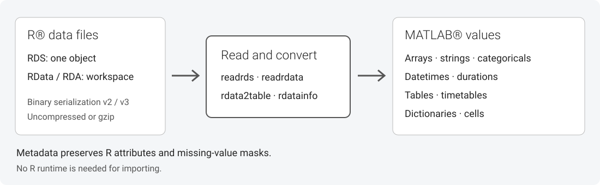

# MATLAB Reader for R Data Files

[](https://matlab.mathworks.com/open/github/v1?repo=mathworks/matlab-reader-for-r-data-files)
[](https://github.com/mathworks/matlab-reader-for-r-data-files/actions/workflows/test.yml)

Import serialized R&reg; data files into MATLAB&reg; without running R during
import. Read analytical data as arrays, strings, categoricals, dates, tables,
and dictionaries, with metadata for missing values and R attributes.



## Install

Requires MATLAB R2025a or later. No separate R, Java&reg;, or Git&trade;
installation is required at runtime.

Download **[rDataReader.mltbx from the latest release](https://github.com/mathworks/matlab-reader-for-r-data-files/releases/latest/download/rDataReader.mltbx)**,
then open the downloaded file in MATLAB or run:

```matlab
matlab.addons.install("rDataReader.mltbx")
```

To use a source checkout instead, add its runtime folder:

```matlab
addpath(fullfile(pwd, "tbx", "rdatareader"))
```

## Import your first table

This example downloads public economic data from the AER package when run.
The repository and toolbox do not include downloaded data or saved output.

```matlab
url = "https://raw.githubusercontent.com/cran/AER/master/data/OECDGrowth.rda";
options = weboptions(Timeout=30, ContentReader=@rdata2table);
T = webread(url, options);
head(T)
```

For local files:

```matlab
value = readrds("data.rds");
workspace = readrdata("workspace.RData");
info = rdatainfo("data.rds");
```

See [Getting Started](tbx/doc/getting-started.md) and the function reference:
[readrds](tbx/doc/readrds.md), [readrdata](tbx/doc/readrdata.md),
[rdata2table](tbx/doc/rdata2table.md), and [rdatainfo](tbx/doc/rdatainfo.md).

## Supported data and limitations

| R data | MATLAB representation |
| --- | --- |
| Logical, integer, real, complex, and raw vectors | Logical, double, complex, and uint8 arrays; optional int32 integers |
| Character vectors | Strings; optional cell arrays of character vectors |
| Matrices and arrays | Arrays with the R dimensions |
| Factors and ordered factors | Categoricals with levels and ordering |
| Date, POSIXct, and difftime values | Datetimes and durations |
| Data frames and tibble-like objects | Tables; optional timetables through rdata2table |
| Named lists and workspaces | Dictionaries with original R names |
| Unnamed lists | Cell arrays |

- Reads `.rds`, `.rda`, and `.RData` files using binary XDR or native binary
  serialization, versions 2 and 3. Supports uncompressed and gzip files.
- ASCII serialization and bzip2, xz, and zstd compression are not supported.
- Duplicate names are rejected explicitly. Table columns with empty, missing,
  or reserved names (`:`, `Properties`, `Row`, `Variables`) are rejected.
  Other names, including spaces and punctuation, are preserved unchanged.
- R missing logical values become `false`; use metadata to distinguish them.
  `TextType="cellstr"` collapses missing and empty strings. `IntegerType="int32"`
  retains the R NA sentinel. See [missing-value details](tbx/doc/readrds.md).
- Functions, environments, formulas, promises, bytecode, external pointers,
  and unsupported class-specific behavior are not reconstructed or executed.
  `PreserveUnsupported="opaque"` provides diagnostic placeholders;
  `"raw"` exposes an unstable internal representation for diagnostics only.
- Fitted model objects do not become executable prediction models. See
  [model adapter scope](docs/MODEL_ADAPTERS.md).
- Files are processed in memory. Large compressed files can require
  substantially more memory than their on-disk size.

See [compatibility and validation](docs/COMPATIBILITY.md),
[troubleshooting](docs/TROUBLESHOOTING.md), and
[release notes](docs/RELEASE_NOTES.md).

## Development and testing

The development project and release build require MATLAB R2026b, plus Rscript
for generated fixtures and oracle tests. From the repository root:

```matlab
openProject("matlab.toml")
buildtool test
```

Run `buildtool testall` for the complete suite. CI retains test and coverage
reports as workflow artifacts. See [DEVELOPMENT.md](DEVELOPMENT.md) for release
builds and testing on the minimum runtime release.

External pull requests are not being accepted. Report reproducible bugs through
[GitHub&reg; issues](https://github.com/mathworks/matlab-reader-for-r-data-files/issues).
For security vulnerabilities, follow [SECURITY.md](SECURITY.md).

## License

[BSD 3-Clause](LICENSE.txt).

<!-- Copyright 2026 The MathWorks, Inc. -->
