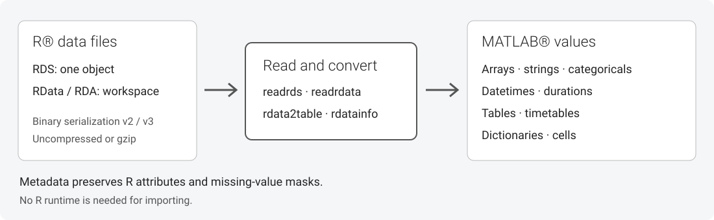

# MATLAB Reader for R Data Files

[](https://matlab.mathworks.com/open/github/v1?repo=mathworks/matlab-reader-for-r-data-files)
[](https://github.com/mathworks/matlab-reader-for-r-data-files/actions/workflows/test.yml)

Import serialized R&reg; data files directly into MATLAB&reg; without running R.
Convert R objects to MATLAB arrays, strings, categoricals, datetimes, tables,
and dictionaries, with metadata that records missing values and R attributes.



## Install

Requires MATLAB R2023a or later. No R, Java&reg;, or Git&trade;
installation is required at runtime.

For MATLAB R2026b or later, install directly from MATLAB with:

```matlab
mpminstall rdatareader
```

For all supported releases, you can also install **MATLAB Reader for R Data Files**
through Add-On Explorer or find it on
[File Exchange](https://www.mathworks.com/matlabcentral/fileexchange/?term=rdatareader).

To install manually, download the latest
[rDataReader.mltbx](https://github.com/mathworks/matlab-reader-for-r-data-files/releases/latest/download/rDataReader.mltbx).
In MATLAB R2026b or later, install the downloaded file with:

```matlab
mpminstall("path/to/rDataReader.mltbx")
```

For earlier supported releases, open the downloaded `.mltbx` file in MATLAB to
install it.

To use a source checkout, clone the repository and add `tbx/rdatareader` to
the path.

## Import your first table

This example downloads and imports public economic data from the R package AER.
The repository and toolbox do not include these data or saved example output.

```matlab
url = "https://raw.githubusercontent.com/cran/AER/master/data/OECDGrowth.rda";
options = weboptions(Timeout=30, ContentReader=@rdata2table);
T = webread(url, options);
head(T)
```

To read local files or inspect their metadata:

```matlab
value = readrds("data.rds");
workspace = readrdata("workspace.RData");
info = rdatainfo("data.rds");
```

See [Getting Started](tbx/doc/getting-started.md) and the function reference:
[readrds](tbx/doc/readrds.md), [readrdata](tbx/doc/readrdata.md),
[rdata2table](tbx/doc/rdata2table.md), and [rdatainfo](tbx/doc/rdatainfo.md).

## Supported data and limitations

| R data | MATLAB representation |
| --- | --- |
| Logical, integer, real, complex, and raw vectors | Logical, double, complex, and `uint8` arrays; integers optionally stored as `int32` |
| Character vectors | String arrays; optional cell arrays of character vectors |
| Matrices and arrays | Arrays that preserve the R dimensions |
| Factors and ordered factors | Categorical arrays that preserve levels and ordering |
| Date, POSIXct, and difftime values | `datetime` and `duration` arrays |
| Data frames and tibble-like objects | Tables; optional timetables through `rdata2table` |
| Named lists and workspaces | Dictionaries that preserve the original R names |
| Unnamed lists | Cell arrays |

- Reads `.rds`, `.rda`, and `.RData` files using binary XDR or native binary
  serialization (versions 2 and 3). Supports uncompressed and gzip-compressed files.
- ASCII serialization and bzip2, xz, and zstd compression are not supported.
- Duplicate names are rejected. Table columns with empty, missing,
  or reserved names (`:`, `Properties`, `Row`, `Variables`) are rejected.
  Other names, including spaces and punctuation, are preserved unchanged.
- R missing logical values become `false`; use metadata to distinguish them.
  With `TextType="cellstr"`, missing and empty strings both become empty character
  vectors. With `IntegerType="int32"`, missing integers retain the R NA sentinel.
  See [missing-value details](tbx/doc/readrds.md).
- Functions, environments, formulas, promises, bytecode, external pointers,
  and unsupported class-specific behavior are not reconstructed or executed.
  `PreserveUnsupported="opaque"` provides diagnostic placeholders;
  `"raw"` exposes an unstable internal representation for diagnostics only.
- Fitted model objects do not become executable prediction models. See
  [model adapter scope](docs/MODEL_ADAPTERS.md).
- Files are processed in memory. Large compressed files can require
  substantially more memory than their on-disk size.

See [compatibility and validation](docs/COMPATIBILITY.md),
[troubleshooting](docs/TROUBLESHOOTING.md), and
[release notes](docs/RELEASE_NOTES.md).

## Development and testing

The development project and release build require MATLAB R2026b. Generating
test fixtures and running oracle tests also require `Rscript`. To run the
default test suite, start from the repository root:

```matlab
openProject("matlab.toml")
buildtool test
```

Run `buildtool testall` for the complete suite. CI saves test and coverage
reports as workflow artifacts. See [DEVELOPMENT.md](DEVELOPMENT.md) for release
builds and testing on the minimum runtime release.

External pull requests are currently not accepted. Report reproducible bugs through
[GitHub&reg; issues](https://github.com/mathworks/matlab-reader-for-r-data-files/issues).
For security vulnerabilities, follow [SECURITY.md](SECURITY.md).

## License

[BSD 3-Clause](LICENSE.txt).

<!-- Copyright 2026 The MathWorks, Inc. -->
